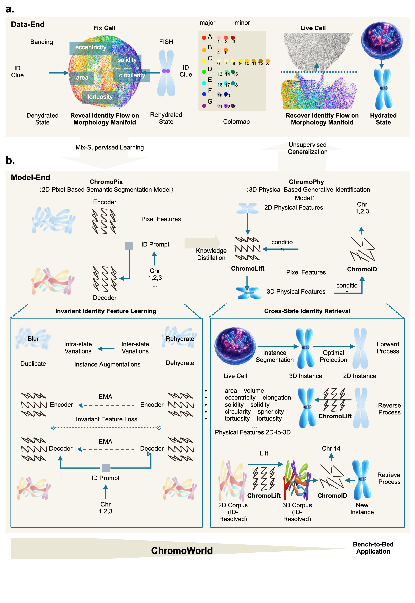
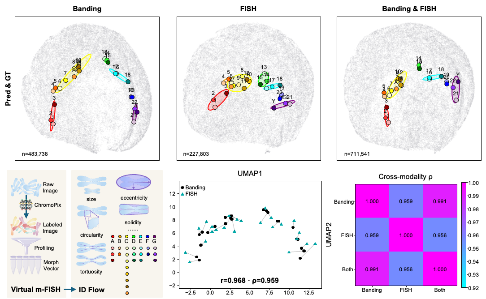
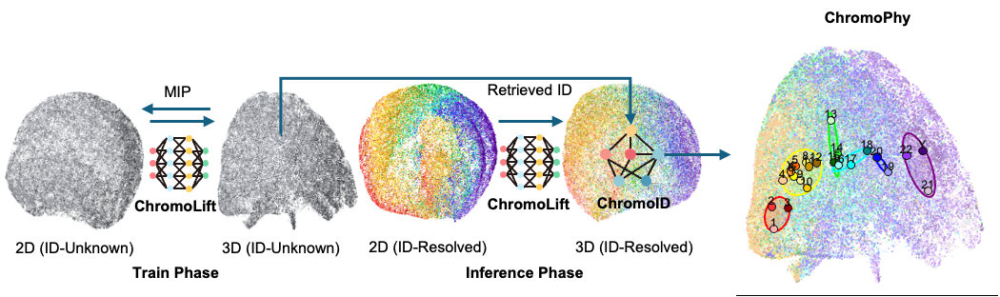

<div align="center">

# ChromoWorld

### Chromosome identity across fixed-cell images and live-cell volumes

**ChromoPix** · **ChromoPose** · **ChromoLift** · **ChromoID**

[Research story](#research-story) · [Quick start](#quick-start) · [Model training](Code/README.md) · [Data and weights](#data-and-weights)

</div>

ChromoWorld connects 24-class chromosome segmentation in Banding and FISH
images with morphology analysis in 3D and 4D. ChromoPix supplies pixel-level
identity predictions. ChromoPose segments live-cell volumes. ChromoLift maps
2D descriptors into 3D feature space, and ChromoID retrieves chromosome
identities from a labeled reference gallery.



## Research story

### ChromoPix: pixel-level chromosome identity

ChromoPix learns chromosome identity from Banding and FISH images using
mixed supervision and invariant feature learning. It predicts a 24-class
chromosome map, extending sparse FISH identity clues into a virtual m-FISH
view of the processed image.


The two demos below each contain five samples with **input / GT / prediction**.
The shared 24-color palette represents chromosome classes. Sparse or
unlabelled FISH GT should not be read as complete 24-class ground truth.

<table>
<tr><th>Banding</th><th>FISH</th></tr>
<tr>
<td></td>
<td></td>
</tr>
</table>

[ChromoPix model guide](Code/ChromoPix/README.md) ·
[Fig2–3 predictions, metrics and demos](Code/Analyze/fig2-3/README.md)

### ChromoPhy: a stable chromosome morphology alphabet

We identify a stable **chromosome morphology alphabet** across dehydrated
Banding and rehydrated FISH states. Size, eccentricity, solidity, circularity
and tortuosity organize chromosome identities into a consistent morphology
manifold despite changes in preparation and appearance. This cross-state
organization motivates morphology-based identity transfer to hydrated,
live-cell chromosomes.



The retained fixed-cell assets contain 711,541 combined Banding/FISH rows.
[Fig4 descriptor extraction, QC and saved UMAP reproduction](Code/Analyze/fig4/README.md)
provides the code and plotting assets for this stage.

### ChromoLift and ChromoID: lifting morphology and retrieving identity

**ChromoLift** maps 2D physical descriptors into 3D feature
space, optionally conditioned on image features. It connects labeled
fixed-cell morphology with the descriptor space of live-cell chromosome
instances. **ChromoID** then assigns candidate identities by retrieving
neighbors from the lifted, labeled reference gallery using the fitted 3D
standardization and distance-weighted kNN.



These assignments are model-inferred identities. Manifold agreement and
embedding colors alone do not establish experimentally verified chromosome
identity for every live-cell instance.

[ChromoLift training and inference](Code/ChromoPhy/chromolift/README.md) ·
[ChromoID gallery and retrieval](Code/ChromoPhy/chromoid/README.md) ·
[Fig5 3D and lifted UMAP assets](Code/Analyze/fig5/README.md)

### ChromoPose: live-cell chromosome instance segmentation

ChromoPose provides instance masks for live-cell 3D volumes and 4D movies.
The figure shows preprocessing and qualitative segmentation comparisons,
alongside the geometric-flow and distance-field approach used to recover
chromosome instances.


The released movie workflow runs **raw / preprocess / affine / segment /
post / track** in that order. ChromoPose resizes frames internally for model
inference and restores instance labels to the affine image grid with
nearest-neighbor interpolation before downstream processing.

[ChromoPose training and inference](Code/ChromoPhy/chromopose/segmentation/README.md) ·
[Full 4D pipeline](Code/Analyze/fig5/README.md) ·
[Retained keyframe demo](Code/Analyze/fig5/demo_outputs/chromopose/chromopose_keyframes_segmentation_8x5.png)

## Two reproduction routes

| Route | Start here | What it produces |
| --- | --- | --- |
| Model development | [Code](Code/README.md) | Training, inference and held-out evaluation |
| Figure reproduction | [Analyze](Code/Analyze/README.md) | Pretrained predictions, descriptors, metrics and saved UMAP views |

Saved UMAP plots run without a GPU or checkpoints. Segmentation needs pretrained
weights and a model environment. Full historical retraining additionally
needs the missing training inputs listed below.

## Quick start

Clone and run commands from the repository root with Python 3.10 or newer:

```bash
git clone https://github.com/daviddaiiiii/ChromoWorld.git
cd ChromoWorld
python3 -m venv .venv
source .venv/bin/activate
python -m pip install numpy matplotlib

# Fixed-cell morphology: saved Banding + FISH coordinates
python Code/Analyze/fig5/visualize-umap_NPZ2PNG.py \
  --embedding-npz Artifacts/fig4/Combine_umap_embed.npz

# Live-cell morphology: saved lifted MIP coordinates
python Code/Analyze/fig5/visualize-umap_NPZ2PNG.py \
  --embedding-npz Artifacts/fig5/LiftedMIP_umap_embed.npz
```

PNG, SVG and plot metadata go directly to
`Code/Analyze/fig4/demo_outputs/` or
`Code/Analyze/fig5/demo_outputs/chromophy/`. The default deterministic
display sample contains at most 100,000 points. Use `--max-points 0` to
render every valid point. This route does not refit UMAP or rerun ChromoLift.

For pretrained ChromoPix inference and evaluation, first obtain the data and
weights in the layout below, then install its model dependencies:

```bash
python -m pip install -r Code/ChromoPix/requirements.txt
python Code/ChromoPix/chromopix/infer.py --gpu_id 0
python Code/ChromoPix/chromopix/evaluate.py --gpu-ids 0
```

See the [ChromoPix guide](Code/ChromoPix/README.md) for CUDA requirements and
evaluation settings. Use a dedicated environment per model. ChromoLift and
ChromoID pin scikit-learn 1.7.1 for checkpoint scaler compatibility.

## Models and repository layout

| Component | Role | Guide |
| --- | --- | --- |
| ChromoPix | DINOv3-based 24-class 2D segmentation | [Train / infer / evaluate](Code/ChromoPix/README.md) |
| ChromoPose | 3D U-Net with maintained two-phase flow decoding | [Train / infer / evaluate](Code/ChromoPhy/chromopose/segmentation/README.md) |
| ChromoLift | 2D-to-3D flow matching | [Train / infer / evaluate](Code/ChromoPhy/chromolift/README.md) |
| ChromoID | Standardized, distance-weighted kNN retrieval | [Build gallery / infer / evaluate](Code/ChromoPhy/chromoid/README.md) |

```text
ChromoWorld/
├── Code/
│   ├── ChromoPix/              model and required DINOv3 source subset
│   ├── ChromoPhy/              chromopose / chromolift / chromoid
│   └── Analyze/                fig2-3 / fig4 / fig5 workflows and demos
├── Artifacts/                  seven UMAP NPZs and fitting metadata
├── Checkpoint/                 weight layout and provenance instructions
├── Dataset/                    data layout and distribution instructions
└── docs/images/                research overview and component figures
```

## Data and weights

GitHub contains code, approximately 40 MB of UMAP assets, and curated demos.
Large image datasets and model weights remain outside Git. Download URLs are
pending publication; a one-command dataset/weight download is not yet available.

| Package | Current size | Expected local path |
| --- | --- | --- |
| 2D train + test, no robustness | About 3.6 GB compressed, sampled estimate | `Dataset/2D/{train,test}/{image,label}` |
| Matched 3D DAPI/Tag package | 37.56 GB, existing archive | `Dataset/3D/DAPI_Tag_matched_1333pairs.tar.gz` |
| Project and third-party weights | Distributed separately | `Checkpoint/` |

[Dataset sizes and publication plan](Dataset/README.md) ·
[Checkpoint layout and provenance](Checkpoint/README.md) ·
[UMAP assets and checksums](Artifacts/README.md)

### Reproduction status

- **Available:** seven saved UMAP projections and plotting code, curated
  demos, model source and analysis entry points.
- **External downloads required:** processed 2D images/labels, paired 3D
  volumes, project and third-party weights.
- **Still needed for complete historical retraining:** Chimps image/mask
  data, historical ChromoLift paired seven-feature records and image conditions,
  the fitted ChromoID gallery, and 4D movies/manifests.

Five-feature UMAP assets cannot replace seven-feature ChromoLift training
inputs or the ChromoID gallery. Redrawing saved coordinates and retraining
the historical models are distinct reproduction tasks.

## Attribution and reuse

The overview and component figures are author-supplied research illustrations.
The Banding/FISH panels are retained Analyze demos. Third-party components include DINOv3,
Cellpose-SAM and optional FAST CHIMP weights; retain upstream notices and
check redistribution terms before publishing weights.

Project code/data licensing and manuscript citation await author confirmation.
No publication DOI or permissive project license is implied.
