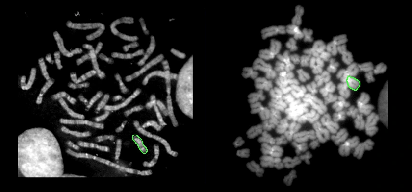
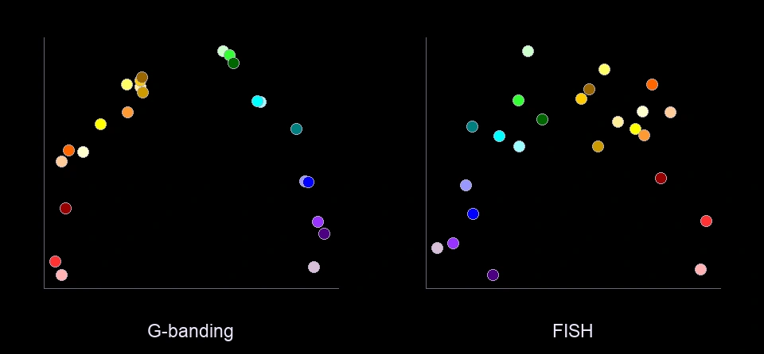
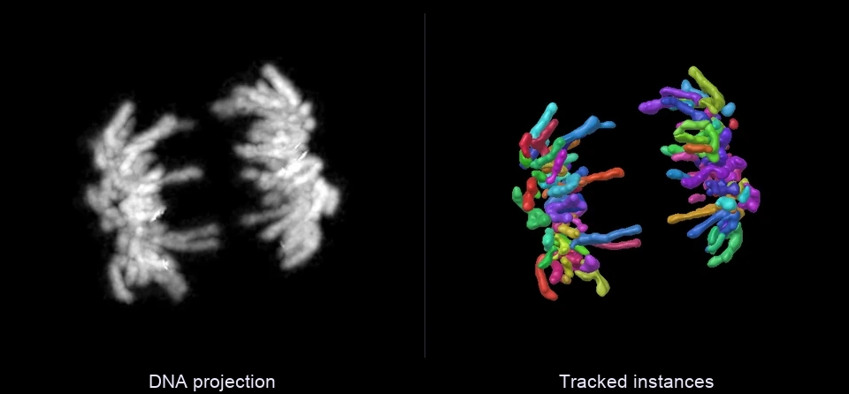

# ChromoWorld

**Following chromosome identity through cell division**

A G-banded spread can tell us which chromosomes a cell contains. Live microscopy
shows where they move. ChromoWorld connects the two by measuring shape in
fixed cells and using those measurements to rank the identities of chromosomes
tracked through mitosis.

[Watch the research film (5:38)](https://daviddaiiiii.github.io/ChromoWorld/) · [Run a first example](#quick-start) · [Download data and weights](#data-and-weights)

| [Fixed-cell atlas](https://daviddaiiiii.github.io/ChromoWorld/virtual-fish/) | [Morphology maps](https://daviddaiiiii.github.io/ChromoWorld/identity-flow/) | [Live-cell movies](https://daviddaiiiii.github.io/ChromoWorld/live-4d/) |
| --- | --- | --- |
| [](https://daviddaiiiii.github.io/ChromoWorld/virtual-fish/) | [](https://daviddaiiiii.github.io/ChromoWorld/identity-flow/) | [](https://daviddaiiiii.github.io/ChromoWorld/live-4d/) |
| Compare annotations and predictions across 24 classes. | Compare class centroids in G-banding, FISH and live cells. | Follow a division or compare three segmentations. |

## Models

ChromoPix supplies the fixed-cell references. In the live-cell pipeline,
ChromoPose separates the chromosomes, ChromoLift builds a reference atlas in
three dimensions, and ChromoID matches each measured shape to candidate identities.

| Component | Input and output | Guide |
| --- | --- | --- |
| **ChromoPix** | Fixed-cell DNA images → 2D instance masks and chromosome classes | [Train, infer and evaluate](Code/ChromoPix/README.md) |
| **ChromoPose** | Live-cell DNA volumes → 3D chromosome instance masks | [Segmentation](Code/ChromoPhy/chromopose/segmentation/README.md) · [4D tracking pipeline](Code/Analyze/fig5/README.md) |
| **ChromoLift** | 2D morphology descriptors → lifted 3D descriptors | [Train and infer](Code/ChromoPhy/chromolift/README.md) |
| **ChromoID** | Live 3D descriptors and labeled references → ranked chromosome identities | [Build the gallery and run retrieval](Code/ChromoPhy/chromoid/README.md) |

## Quick start

**Plot the fixed-cell morphology map on a CPU.** The embedding is included in
the repository. Python 3.10 or later and the two packages below are sufficient.

```bash
git clone https://github.com/daviddaiiiii/ChromoWorld.git
cd ChromoWorld
python3 -m venv .venv
source .venv/bin/activate
python -m pip install numpy matplotlib
python Code/Analyze/fig4/visualize-umap_NPZ2PNG.py \
  --embedding-npz Artifacts/fig4/Combine_umap_embed.npz
```

Use `Artifacts/fig5/LiftedMIP_umap_embed.npz` for the live-cell projection.
The [saved embeddings guide](Artifacts/README.md) lists all seven projections
and their checksums. [Figure workflows](Code/Analyze/README.md) cover predictions,
descriptors, metrics and rendering.

**Run inference.** Set up the [data](Dataset/README.md) and
[weights](docs/downloads.md), then use the model's dedicated environment.
For ChromoPix on a CUDA device:

```bash
python -m pip install -r Code/ChromoPix/requirements.txt
python Code/ChromoPix/chromopix/infer.py --gpu_id 0
python Code/ChromoPix/chromopix/evaluate.py --gpu-ids 0
```

## Data and weights

| Package | Contents | Download |
| --- | --- | --- |
| **2D** | 13,680 fixed-cell image–polygon pairs, 3.61 GB | [Archive](https://drive.google.com/file/d/1uiI7PR-H7DH77jsTPzEdkelMbMvmqB6x/view?usp=drivesdk) · [Layout](Dataset/README.md#2d-chromosome-images-and-polygon-annotations) |
| **3D** | 1,333 paired live-cell DNA/Tag volumes, 37.56 GB | [Archive](https://drive.google.com/file/d/1EoJxi3dP494kBQNJnXOkgXqhCznqACgo/view?usp=drivesdk) · [Layout](Dataset/README.md#3d-matched-dapitag-volumes) |
| **4D** | 55 live-cell movies with images, masks, tracks and previews, 12.17 GB | [Archive](https://drive.google.com/file/d/1183tSn6ZAoZal6WO3oM08LSb6Q3TvG3o/view?usp=drivesdk) · [Layout and checksum](Dataset/README.md#4d-live-cell-movies-predicted-masks-and-tracks) |
| **Model weights** | ChromoPix, ChromoPose and ChromoLift checkpoints | [Drive folder](https://drive.google.com/drive/folders/1B4LLQiesGVCVG3aq-7846YpRV52jHJg3) · [Setup](Checkpoint/README.md) |

Drive archives may require access. The [download guide](docs/downloads.md)
includes official upstream links and setup instructions for DINOv3, Cellpose-SAM,
CARE, EmbedSeg, VoxelMorph, FAST-CHIMP and Chimps.

<a id="research-story"></a>

## Interpreting the results

[Read the illustrated research overview](docs/research.md) for the fixed-cell
identity experiments, cross-state morphology maps and the live-cell pipeline.
The fixed-cell atlas pairs predictions with annotations. In the live-cell
movies, a colored track follows a segmented object through time. A chromosome
number attached to that track represents a model-inferred candidate identity.

The [reproduction guide](Code/Analyze/README.md) separates saved-figure
reproduction from full historical retraining. The historical ChromoLift
training pairs and fitted ChromoID gallery are outside this release.

## Repository guide

- [`Code/`](Code/README.md) contains the models, movie pipeline and figure workflows.
- [`Artifacts/`](Artifacts/README.md) contains the saved morphology embeddings.
- [`Dataset/`](Dataset/README.md) and [`Checkpoint/`](Checkpoint/README.md) document downloads and local layouts.
- [`site/`](site/README.md) contains the interactive website and browser-ready assets.

Project licensing and manuscript citation await author confirmation. Third-party
components retain their upstream attribution and terms.
