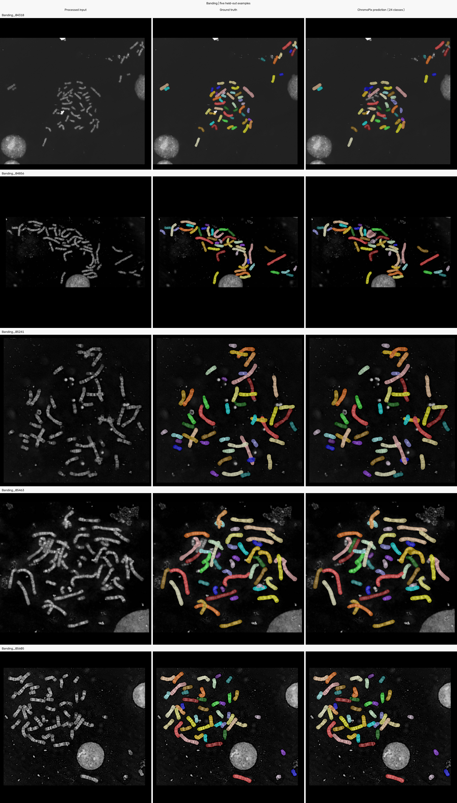
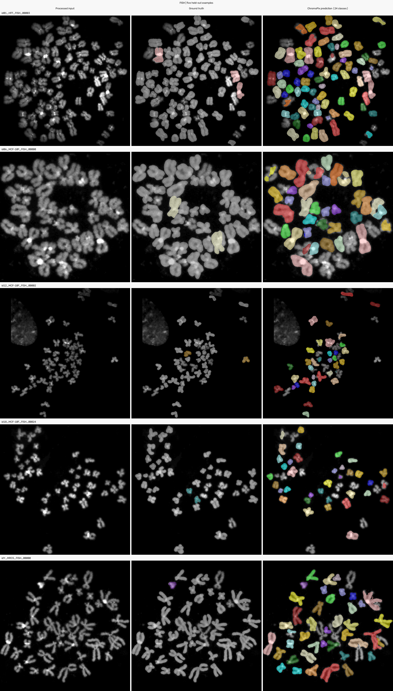
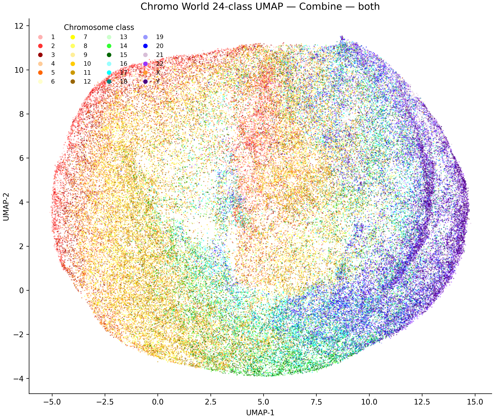
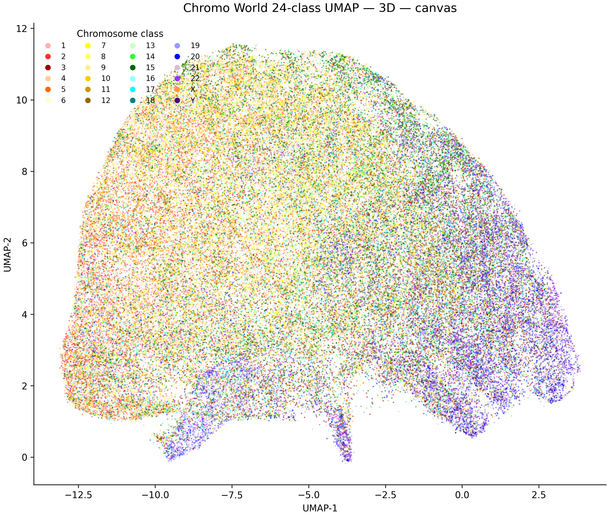
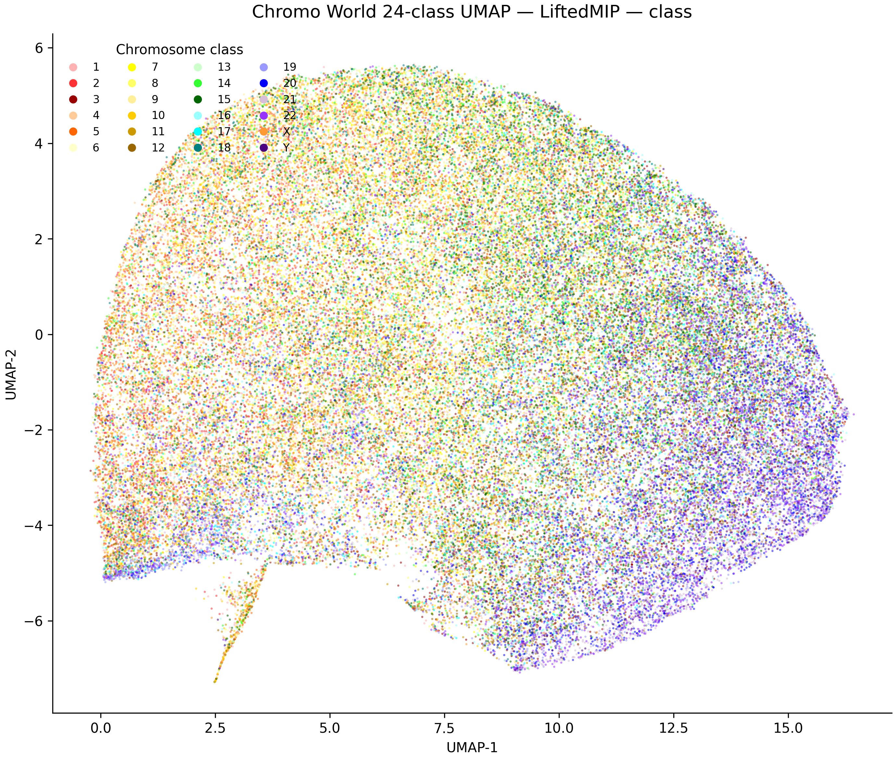
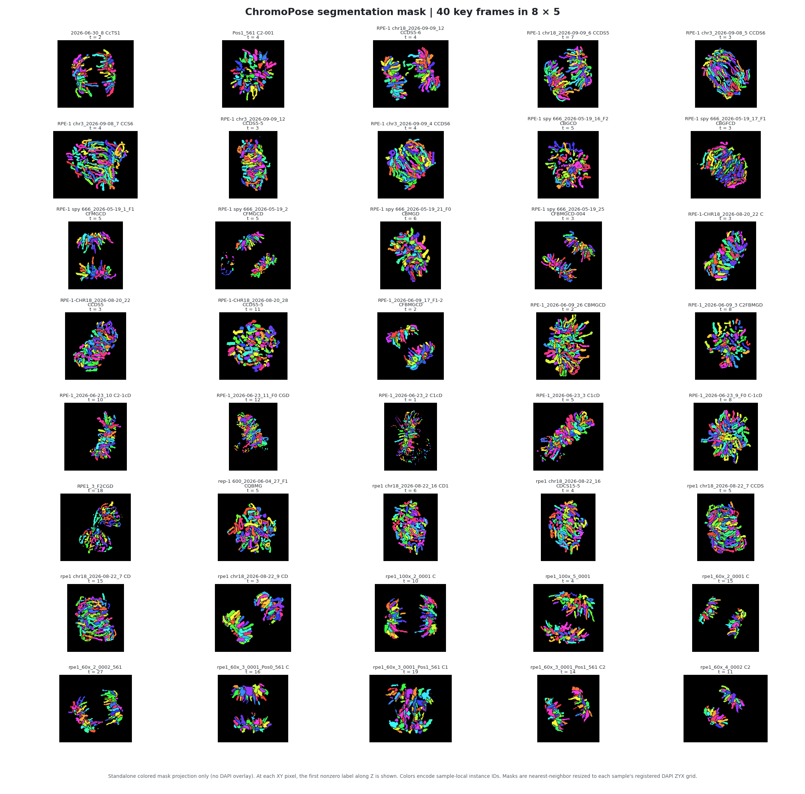

<div align="center">

# ChromoWorld

### Chromosome identity across fixed-cell images and live-cell volumes

**ChromoPix** · **ChromoPose** · **ChromoLift** · **ChromoID**

[Quick start](#quick-start) · [Figure gallery](#figure-gallery) · [Model training](Code/README.md) · [Data and weights](#data-and-weights)

</div>

ChromoWorld connects 24-class chromosome segmentation in Banding and FISH
images with morphology analysis in 3D and 4D. ChromoPix supplies pixel-level
identity predictions. ChromoPose segments live-cell volumes. ChromoLift maps
2D descriptors into 3D feature space, and ChromoID retrieves chromosome
identities from a labeled reference gallery.


<sub>Research overview from the project presentation, slide 1. The reproduction
status below describes the assets currently released.</sub>

## Two reproduction routes

| Route | Start here | What it produces |
| --- | --- | --- |
| Model development | [Code](Code/README.md) | Training, inference and held-out evaluation |
| Figure reproduction | [Analyze](Code/Analyze/README.md) | Pretrained predictions, descriptors, metrics and saved UMAP views |

Saved UMAP plots run without a GPU or checkpoints. Segmentation needs pretrained
weights and a model environment. Full historical retraining additionally
needs the missing training inputs listed below.

## Quick start

Clone and run commands from the repository root with Python 3.10 or newer:

```bash
git clone https://github.com/daviddaiiiii/ChromoWorld.git
cd ChromoWorld
python3 -m venv .venv
source .venv/bin/activate
python -m pip install numpy matplotlib

# Fixed-cell morphology: saved Banding + FISH coordinates
python Code/Analyze/fig5/visualize-umap_NPZ2PNG.py \
  --embedding-npz Artifacts/fig4/Combine_umap_embed.npz

# Live-cell morphology: saved lifted MIP coordinates
python Code/Analyze/fig5/visualize-umap_NPZ2PNG.py \
  --embedding-npz Artifacts/fig5/LiftedMIP_umap_embed.npz
```

PNG, SVG and plot metadata go directly to
`Code/Analyze/fig4/demo_outputs/` or
`Code/Analyze/fig5/demo_outputs/chromophy/`. The default deterministic
display sample contains at most 100,000 points. Use `--max-points 0` to
render every valid point. This route does not refit UMAP or rerun ChromoLift.

For pretrained ChromoPix inference and evaluation, first obtain the data and
weights in the layout below, then install its model dependencies:

```bash
python -m pip install -r Code/ChromoPix/requirements.txt
python Code/ChromoPix/chromopix/infer.py --gpu_id 0
python Code/ChromoPix/chromopix/evaluate.py --gpu-ids 0
```

See the [ChromoPix guide](Code/ChromoPix/README.md) for CUDA requirements and
evaluation settings. Use a dedicated environment per model. ChromoLift and
ChromoID pin scikit-learn 1.7.1 for checkpoint scaler compatibility.

## Figure gallery

### Fig2–3 · Banding and FISH segmentation

Each panel contains five samples, with input, GT and 24-color prediction.
Colors encode chromosome classes, not confidence.

<table>
<tr><th>Banding</th><th>FISH</th></tr>
<tr>
<td></td>
<td></td>
</tr>
</table>

[Reproduce predictions, metrics and panels](Code/Analyze/fig2-3/README.md).

### Fig4 · Fixed-cell morphology

The Banding and FISH assets contain 711,541 combined rows. This view uses
saved coordinates and the deterministic display sample.



[Banding](Code/Analyze/fig4/demo_outputs/umap_banding_both_24class.png) ·
[FISH](Code/Analyze/fig4/demo_outputs/umap_fish_both_24class.png) ·
[Descriptor extraction, QC and plotting](Code/Analyze/fig4/README.md)

### Fig5 · Volume morphology and lifted features

<table>
<tr><th>3D morphology</th><th>Lifted MIP morphology</th></tr>
<tr>
<td></td>
<td></td>
</tr>
</table>

The saved spaces are **3D / MIP / LiftedMIP / Lifted2D**. Labels come from
stored reference or inference arrays. Embedding colors alone do not establish
experimentally verified chromosome identity.

<details>
<summary><strong>ChromoPose keyframe segmentation demo</strong></summary>



Retained qualitative demo. The 4D pipeline runs raw, preprocess, affine,
segment, post and track stages. Masks return to the affine image grid after
internal inference resizing.

</details>

[3D descriptors, 4D processing and UMAP reproduction](Code/Analyze/fig5/README.md).

## Models and repository layout

| Component | Role | Guide |
| --- | --- | --- |
| ChromoPix | DINOv3-based 24-class 2D segmentation | [Train / infer / evaluate](Code/ChromoPix/README.md) |
| ChromoPose | 3D U-Net with maintained two-phase flow decoding | [Train / infer / evaluate](Code/ChromoPhy/chromopose/segmentation/README.md) |
| ChromoLift | Seven-feature 2D-to-3D flow matching | [Train / infer / evaluate](Code/ChromoPhy/chromolift/README.md) |
| ChromoID | Standardized, distance-weighted kNN retrieval | [Build gallery / infer / evaluate](Code/ChromoPhy/chromoid/README.md) |

```text
ChromoWorld/
├── Code/
│   ├── ChromoPix/              model and required DINOv3 source subset
│   ├── ChromoPhy/              chromopose / chromolift / chromoid
│   └── Analyze/                fig2-3 / fig4 / fig5 workflows and demos
├── Artifacts/                  seven UMAP NPZs and fitting metadata
├── Checkpoint/                 weight layout and provenance instructions
├── Dataset/                    data layout and distribution instructions
└── docs/images/                presentation-derived overview
```

## Data and weights

GitHub contains code, approximately 40 MB of UMAP assets, and curated demos.
Large image datasets and model weights remain outside Git. Download URLs are
pending publication; a one-command dataset/weight download is not yet available.

| Package | Current size | Expected local path |
| --- | --- | --- |
| 2D train + test, no robustness | About 3.6 GB compressed, sampled estimate | `Dataset/2D/{train,test}/{image,label}` |
| Matched 3D DAPI/Tag package | 37.56 GB, existing archive | `Dataset/3D/DAPI_Tag_matched_1333pairs.tar.gz` |
| Project and third-party weights | Distributed separately | `Checkpoint/` |

[Dataset sizes and publication plan](Dataset/README.md) ·
[Checkpoint layout and provenance](Checkpoint/README.md) ·
[UMAP assets and checksums](Artifacts/README.md)

### Reproduction status

- **Available:** seven saved UMAP projections and plotting code, curated
  demos, model source and analysis entry points.
- **External downloads required:** processed 2D images/labels, paired 3D
  volumes, project and third-party weights.
- **Still needed for complete historical retraining:** Chimps image/mask
  data, historical ChromoLift paired seven-feature records and image conditions,
  the fitted ChromoID gallery, and 4D movies/manifests.

Five-feature UMAP assets cannot replace seven-feature ChromoLift training
inputs or the ChromoID gallery. Redrawing saved coordinates and retraining
the historical models are distinct reproduction tasks.

## Attribution and reuse

The overview comes from the project's `chromoworld.pptx`, slide 1. Gallery
images are retained Analyze demos. Third-party components include DINOv3,
Cellpose-SAM and optional FAST CHIMP weights; retain upstream notices and
check redistribution terms before publishing weights.

Project code/data licensing and manuscript citation await author confirmation.
No publication DOI or permissive project license is implied.
