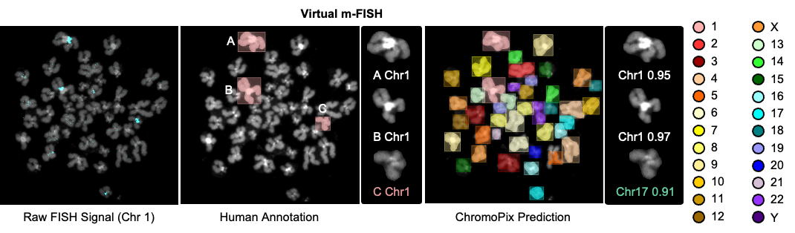
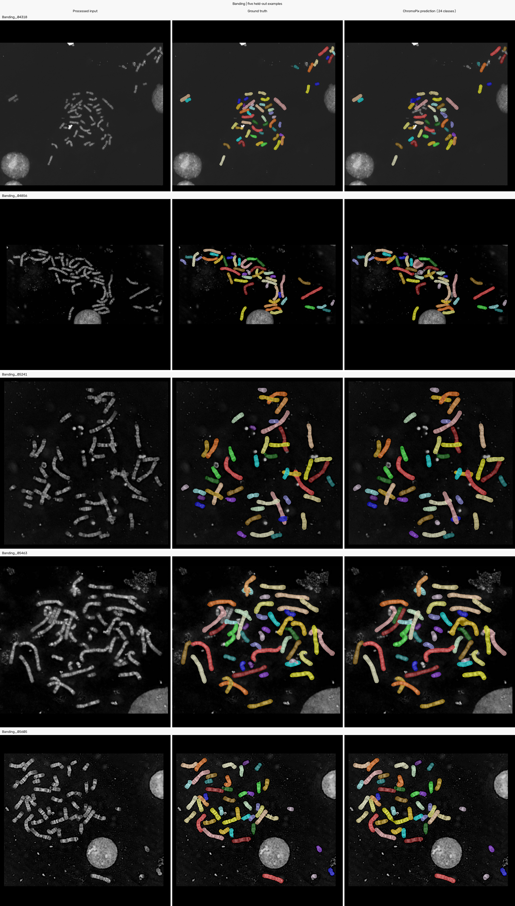
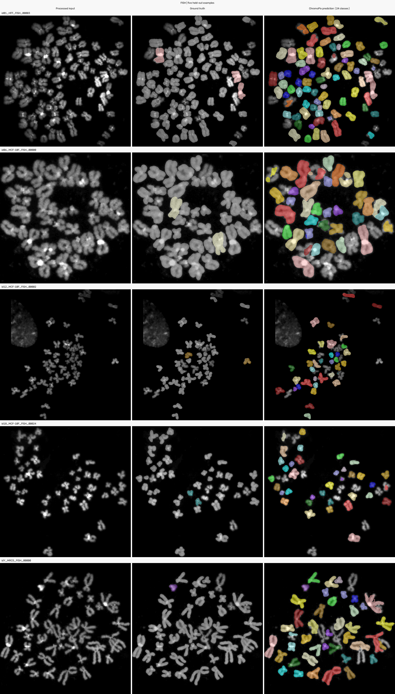
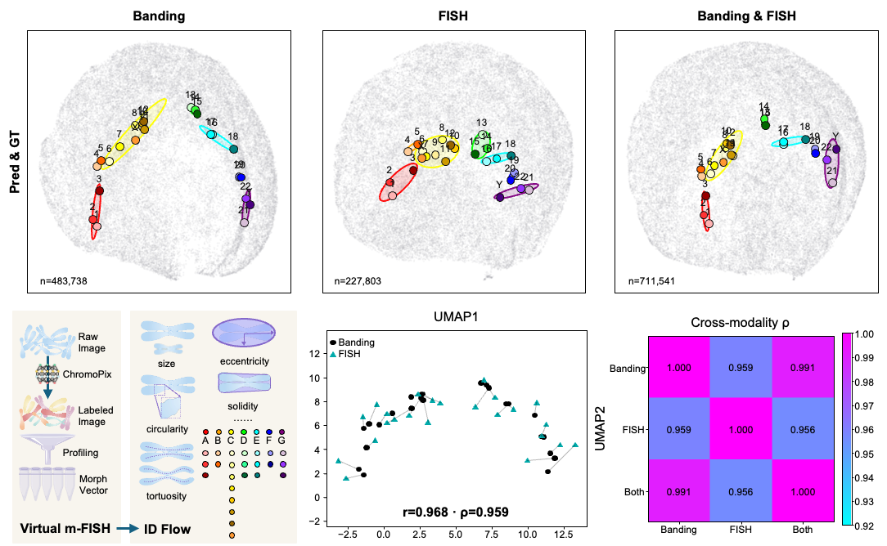
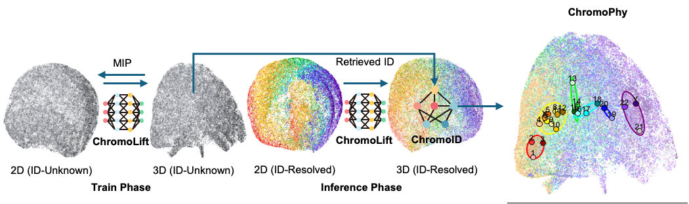
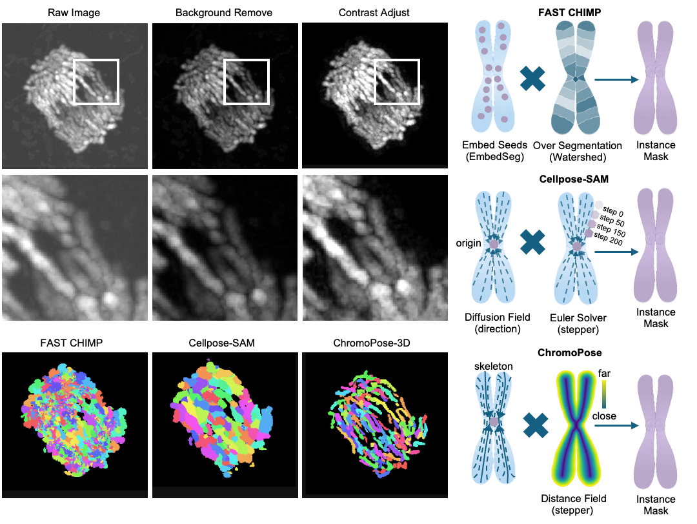

# ChromoWorld research overview

[Repository guide](../README.md) · [Interactive project site](https://daviddaiiiii.github.io/ChromoWorld/)

### ChromoPix: pixel-level chromosome identity

ChromoPix learns chromosome identity from Banding and FISH images using
mixed supervision and invariant feature learning. It predicts a 24-class
chromosome map, extending sparse FISH identity clues into a virtual m-FISH
view of the processed image.

The two demos below each contain five samples with **input / GT / prediction**.
The shared 24-color palette represents chromosome classes. Sparse or
unlabelled FISH GT should not be read as complete 24-class ground truth.

<table>
<tr><th>Banding</th><th>FISH</th></tr>
<tr>
<td></td>
<td></td>
</tr>
</table>

[ChromoPix model guide](../Code/ChromoPix/README.md) ·
[Fig2–3 predictions, metrics and demos](../Code/Analyze/fig2-3/README.md)

### ChromoPhy: a stable chromosome morphology alphabet

We identify a stable **chromosome morphology alphabet** across dehydrated
Banding and rehydrated FISH states. Size, eccentricity, solidity, circularity
and tortuosity organize chromosome identities into a consistent morphology
manifold despite changes in preparation and appearance. This cross-state
organization motivates morphology-based identity transfer to hydrated,
live-cell chromosomes.

The retained fixed-cell assets contain 711,541 combined Banding/FISH rows.
[Fig4 descriptor extraction, QC and saved UMAP reproduction](../Code/Analyze/fig4/README.md)
provides the code and plotting assets for this stage.

### ChromoLift and ChromoID: lifting morphology and retrieving identity

**ChromoLift** maps 2D physical descriptors into 3D feature
space, optionally conditioned on image features. It connects labeled
fixed-cell morphology with the descriptor space of live-cell chromosome
instances. **ChromoID** then assigns candidate identities by retrieving
neighbors from the lifted, labeled reference gallery using the fitted 3D
standardization and distance-weighted kNN.

These assignments are model-inferred identities. Manifold agreement and
embedding colors alone do not establish experimentally verified chromosome
identity for every live-cell instance.

[ChromoLift training and inference](../Code/ChromoPhy/chromolift/README.md) ·
[ChromoID gallery and retrieval](../Code/ChromoPhy/chromoid/README.md) ·
[Fig5 3D and lifted UMAP assets](../Code/Analyze/fig5/README.md)

### ChromoPose: live-cell chromosome instance segmentation

ChromoPose provides instance masks for live-cell 3D volumes and 4D movies.
The figure shows preprocessing and qualitative segmentation comparisons,
alongside the geometric-flow and distance-field approach used to recover
chromosome instances.

The released movie workflow runs **raw / preprocess / affine / segment /
post / track** in that order. ChromoPose resizes frames internally for model
inference and restores instance labels to the affine image grid with
nearest-neighbor interpolation before downstream processing.
Optional `--auto-crop` inserts a native-grid, all-time XYZ crop before
preprocessing and after registration; it never resamples intensities or labels.
The independent [auto-crop CLI](../Code/Analyze/fig5/README.md#standalone-automatic-crop)
also supports applying one DAPI-derived box to already aligned mask/Tag TIFFs.

[ChromoPose training and inference](../Code/ChromoPhy/chromopose/segmentation/README.md) ·
[Full 4D pipeline](../Code/Analyze/fig5/README.md) ·
[Retained keyframe demo](../Code/Analyze/fig5/demo_outputs/chromopose/chromopose_keyframes_segmentation_8x5.png)
